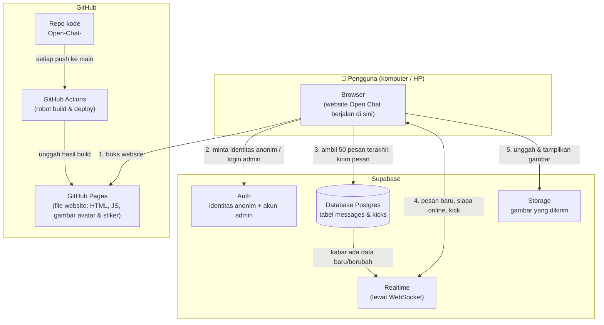
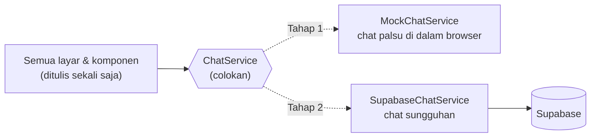
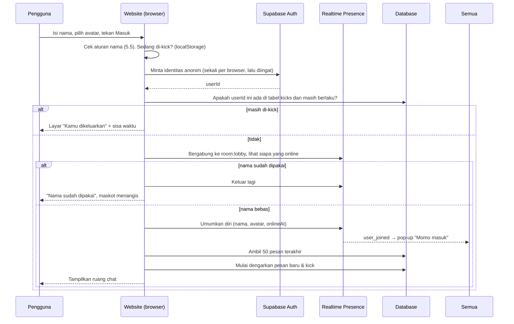
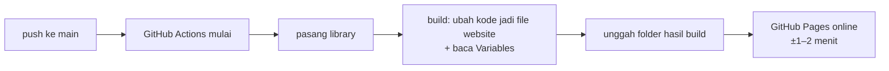

# Arsitektur — Open Chat (Monchhichi & Crybaby)

> Dokumen ini menjelaskan **apa** yang akan dibangun dan **bagaimana** cara
> membangunnya, dengan bahasa yang bisa dibaca tanpa latar belakang
> pemrograman. Setiap istilah teknis dijelaskan dalam satu kalimat saat pertama
> kali muncul (ditandai **tebal**).
>
> Sumber kebutuhan: `docs/requirements.md` dan hasil tanya-jawab (grilling).

---

## 1. Penjelasan proyek dan tujuannya

**Open Chat** adalah satu ruang chat anonim yang bisa dibuka siapa saja yang
punya link-nya, di komputer maupun HP. Tidak ada pendaftaran akun: pengunjung
cukup mengetik nama panggilan, memilih avatar karakter, lalu langsung mengobrol
bersama semua orang di ruang yang sama.

Tema tampilan: **Monchhichi & Crybaby** — warna pastel, imut, dengan maskot
Monchhichi yang menyapa dan ikut bereaksi terhadap obrolan.

**Tujuan:**
1. Siapa pun bisa ikut ngobrol dalam hitungan detik, tanpa login.
2. Terasa hidup: terlihat siapa yang online, ada pemberitahuan orang masuk/keluar,
   pesan muncul langsung tanpa perlu refresh.
3. Tetap bisa dijaga: setiap orang bisa menyembunyikan hal yang tidak ia suka,
   dan kamu sebagai admin bisa menghapus pesan serta mengeluarkan orang.
4. Bisa dibangun bertahap: tampilannya bisa dilihat dulu, baru disambungkan ke
   server sungguhan.

**Ringkasan hasil kesepakatan:**

| # | Topik | Keputusan |
|---|---|---|
| 1 | Riwayat | Yang baru masuk melihat 50 pesan terakhir |
| 2 | Nama kembar | Nama yang sedang dipakai orang online ditolak, harus ganti |
| 3 | Avatar | 6–8 karakter siap pakai, wajib pilih sebelum masuk |
| 4 | Masuk/keluar | Pop-up kecil di pojok, hilang sendiri |
| 5 | Daftar online | Panel samping (komputer), tombol "👥 N online" (HP) |
| 6 | Isi pesan | Teks, stiker Monchhichi, gambar/foto |
| 7 | Moderasi | "Sembunyikan/blokir untuk saya" + hapus oleh admin |
| 8 | Admin | Hapus pesan (dengan tanda "dihapus oleh admin") + kick |
| 9 | Masuk admin | Tautan "Admin" + kata sandi, nama diberi 👑 |
| 10 | Kembali lagi | Nama & avatar terakhir terisi otomatis, ada tombol Keluar |
| 11 | Bahasa | ID / EN / 中文, awalnya mengikuti bahasa browser |
| 12 | Pesan baru | Tombol "⬇ Pesan baru", angka di judul tab, bunyi (bisa dimatikan) |
| 13 | Maskot | Hiasan + maskot hidup yang menyapa + bereaksi terhadap chat |
| 14 | Gambar | Thumbnail, klik untuk diperbesar, pratinjau sebelum kirim, maks. 5 MB |

---

## 2. Diagram arsitektur keseluruhan

Istilah yang dipakai di diagram:

- **Browser** adalah aplikasi untuk membuka website, misalnya Chrome atau Safari, di komputer atau HP.
- **Frontend** adalah bagian website yang berjalan di browser pengguna: semua yang dilihat dan diklik.
- **GitHub Pages** adalah layanan gratis dari GitHub untuk menaruh website, tetapi hanya bisa menyimpan file yang isinya tetap (tidak bisa menjalankan program di server).
- **GitHub Actions** adalah "robot" milik GitHub yang otomatis menjalankan langkah-langkah (misalnya menyiapkan dan mengunggah website) setiap kali ada perubahan di repo.
- **Supabase** adalah layanan siap pakai yang menyediakan database, sistem identitas pengguna, penyimpanan file, dan pengiriman data langsung — jadi kita tidak perlu membuat server sendiri.
- **WebSocket** adalah sambungan yang tetap terbuka antara browser dan server, sehingga server bisa langsung "mendorong" pesan baru ke browser tanpa browser harus bertanya terus-menerus.



**Cara membacanya:** browser pertama-tama mengambil "kerangka" website dari
GitHub Pages. Setelah itu, semua yang hidup — pesan, daftar online, gambar —
didapat langsung dari Supabase. GitHub Pages tidak pernah menyentuh isi chat.

---

## 3. Pilihan teknis

### 3.1 Frontend

| Bagian | Pilih apa | Kenapa |
|---|---|---|
| Bahasa pemrograman | **TypeScript** — JavaScript (bahasa yang dimengerti browser) yang ditambah "label jenis data", sehingga salah ketik atau salah bentuk data ketahuan sebelum website dijalankan. | Ada banyak jenis data (teks, stiker, gambar, pesan dihapus, admin, kick). Label jenis data mencegah kesalahan seperti menampilkan gambar padahal isinya teks. |
| Framework | **React** — **framework** (kerangka kerja siap pakai) untuk membuat tampilan dari potongan-potongan kecil bernama **komponen** (misalnya "gelembung pesan" atau "daftar online"). | Layar chat punya banyak bagian yang berubah bersamaan. React otomatis memperbarui bagian yang datanya berubah saja. Komunitasnya sangat besar, jadi mudah mencari bantuan. |
| Alat build | **Vite** — alat yang mengubah kode kita menjadi file website biasa (proses ini disebut **build**). | Hasilnya file statis yang cocok untuk GitHub Pages, dan prosesnya cepat. |
| Gaya tampilan | **CSS** (bahasa untuk mengatur warna, ukuran, dan tata letak) dengan satu file tema berisi warna pastel. | Warna dan gaya ditentukan lewat `/design`. Satu file tema memudahkan penggantian warna di seluruh website sekaligus. |
| Maskot & avatar | **SVG** (gambar yang dibuat dari garis dan bentuk sehingga tetap tajam di layar sebesar apa pun) + animasi CSS, digambar langsung oleh komponen React (bukan file gambar terpisah). Bunyi notifikasi juga dibuat langsung oleh browser (Web Audio), jadi tidak ada file suara. | Ringan, tajam di HP, warnanya bisa diganti per avatar, dan bisa dianimasikan (berkedip, melompat, melambai, menangis). |
| Terjemahan | Tiga file kamus sederhana: Indonesia, Inggris, Mandarin tradisional. | Cukup untuk tiga bahasa, tanpa perlu tambahan yang berat. |
| Penyimpanan di browser | **localStorage** — "laci kecil" di browser yang menyimpan catatan untuk website ini saja, dan tetap ada setelah tab ditutup. | Untuk mengingat nama dan avatar terakhir, bahasa, bunyi nyala/mati, pesan atau orang yang disembunyikan, dan waktu kick. |

### 3.2 Fitur Supabase

Istilah yang dipakai di bagian ini:

- **Database** adalah tempat menyimpan data secara rapi dalam bentuk **tabel** (seperti lembar Excel: setiap baris satu data, setiap kolom satu jenis keterangan).
- **Postgres** adalah jenis database yang dipakai Supabase.

| Kebutuhan | Pilih apa | Kenapa |
|---|---|---|
| Menyimpan pesan dan menampilkan 50 pesan terakhir | **Database Postgres**, tabel `messages` | Pesan harus tetap ada walaupun semua orang menutup browser. |
| Pesan baru langsung muncul di layar semua orang | **Realtime – Postgres Changes**: fitur yang memberi kabar lewat WebSocket setiap kali ada baris baru atau baris yang berubah di tabel. | Tidak perlu refresh, dan tidak perlu membuat server sendiri. |
| Daftar online, pop-up masuk/keluar, cek nama kembar | **Realtime – Presence**: fitur yang mencatat siapa saja yang sedang tersambung saat ini dan memberi tahu kalau ada yang datang atau pergi. | Presence otomatis tahu kalau seseorang menutup tab atau koneksinya putus. |
| Identitas setiap pengunjung tanpa daftar akun | **Auth – Anonymous Sign-In**. **Auth** adalah sistem identitas pengguna. **Anonymous Sign-In** membuat identitas tanpa nama dan tanpa kata sandi. | Pengguna tidak melihat apa-apa, tapi server tetap bisa memastikan "pesan ini benar dari orang ini". Ini diperlukan untuk kick, blokir, dan mencegah orang menyamar. |
| Akun admin | **Auth – email + kata sandi**, satu akun yang diberi tanda `admin` | Kata sandi disimpan aman oleh Supabase dalam bentuk teracak, tidak pernah ada di kode website. |
| Menyimpan gambar | **Storage**: tempat menyimpan file (seperti Google Drive) dengan bucket `chat-images`. **Bucket** adalah satu "folder utama" di Storage. | Gambar terlalu besar untuk ditaruh di database. Storage bisa membatasi ukuran (5 MB) dan jenis file. |
| Kick | Tabel `kicks` + Realtime | Kalau kick dikirim lewat tabel, hanya admin yang bisa melakukannya. Pesan "broadcast" biasa bisa dikirim siapa saja (lihat bagian 9). |
| Menjaga keamanan data | **RLS (Row Level Security)**: aturan di server yang memeriksa setiap permintaan, misalnya "hanya admin boleh menghapus". | Aturan di server tidak bisa diakali dari browser. Ini penjaga utama. |
| Aturan otomatis di database | **Trigger**: aturan yang otomatis berjalan setiap kali data ditambah atau diubah. | Untuk mengisi tanda 👑 secara jujur, mengosongkan isi pesan yang dihapus admin, dan menahan spam. |

**Fitur Supabase yang sengaja tidak dipakai:**

- **Edge Functions** (program kecil yang berjalan di server Supabase) tidak dipakai, karena semua kebutuhan sudah bisa ditangani oleh RLS dan trigger.
- **Realtime Broadcast** untuk perintah admin tidak dipakai, karena siapa pun bisa mengirim broadcast palsu.

---

## 4. Dua tahap pembangunan

### 4.0 Kuncinya: satu "colokan" bernama `ChatService`

Supaya tahap 2 tidak perlu menulis ulang semuanya, seluruh tampilan **tidak
pernah berbicara langsung dengan Supabase**. Tampilan hanya berbicara dengan satu
perantara bernama **`ChatService`**: daftar perintah dan kabar yang disepakati
(isinya ada di bagian 5).

Bayangkan seperti colokan listrik: lampu (tampilan) hanya perlu colokan yang
bentuknya cocok, dan tidak peduli listriknya dari PLN atau dari genset.



- **Mock** adalah versi tiruan yang meniru perilaku aslinya untuk keperluan mencoba-coba.
- Pilihan versi mana yang dipakai diatur oleh satu pengaturan, `VITE_CHAT_MODE`, yang isinya `mock` atau `supabase`.
- Pada tahap 2, yang ditambahkan **hanya satu file baru** (`SupabaseChatService`) dan pengaturan tadi diganti. Layar-layarnya tidak diubah.

### 4.1 Tahap 1 — Sebelum tersambung ke Supabase

**Yang sudah bisa dibuat dan dicoba (semua tampilan dan perilaku):**

- Layar masuk: maskot menyapa, kolom nama, pilihan avatar, pemilih bahasa, tautan Admin.
- Penolakan nama kembar, diuji dengan nama milik pengguna palsu yang sedang "online".
- Ruang chat berisi 50 pesan contoh, dengan gelembung pesan sendiri di kanan dan pesan orang lain di kiri.
- Mengirim teks, stiker, dan gambar. Gambar menampilkan pratinjau sebelum dikirim dan bisa diperbesar setelah dikirim. Untuk sementara gambar hanya disimpan di memori browser.
- Beberapa **pengguna palsu (bot)** yang masuk, keluar, dan mengirim pesan secara acak, sehingga pop-up, daftar online, tombol "⬇ Pesan baru", angka di judul tab, bunyi, dan reaksi maskot bisa dilihat.
- Sembunyikan pesan dan blokir orang untuk diri sendiri.
- Mode admin dengan kata sandi contoh `demo`: lencana 👑, hapus pesan, kick bot, dan layar "Kamu dikeluarkan" (dicoba dengan tombol simulasi).
- Banner "Koneksi terputus…", dicoba dengan tombol simulasi.
- Tiga bahasa, tampilan komputer, dan tampilan HP.

**Yang belum bisa:** orang sungguhan saling melihat. Setiap pengunjung
mendapat ruang tiruannya sendiri di browsernya.

**Cara melihat hasilnya di GitHub Pages:**

1. Setiap kali kode di-push ke `main`, GitHub Actions otomatis menjalankan build dan mengunggah hasilnya ke GitHub Pages (detailnya di bagian 12).
2. Buka `https://<username-github>.github.io/Open-Chat-/` di komputer atau HP.
3. Di pojok layar ada label kecil **"Mode demo"** supaya jelas bahwa yang terlihat adalah chat tiruan.

### 4.2 Tahap 2 — Setelah tersambung ke Supabase

| Hal | Tahap 1 (mock) | Tahap 2 (Supabase) |
|---|---|---|
| Lawan bicara | Bot palsu | Orang sungguhan dari browser atau HP lain |
| 50 pesan terakhir | Pesan contoh | Diambil dari tabel `messages` |
| Pesan setelah refresh | Hilang (kembali ke contoh) | Tetap ada |
| Daftar online & pop-up | Dari bot | Dari Realtime Presence |
| Cek nama kembar | Dibandingkan dengan nama bot | Dibandingkan dengan semua orang online sungguhan |
| Gambar | Di memori browser | Diunggah ke Supabase Storage |
| Kata sandi admin | `demo` | Kata sandi akun admin di Supabase Auth |
| Hapus / kick | Hanya di layar sendiri | Berlaku untuk semua orang, dijaga RLS |
| Label "Mode demo" | Tampil | Hilang |

**Yang tidak berubah:** semua layar, komponen, terjemahan, maskot, tema, dan
penyimpanan di localStorage.

---

## 5. Aturan komunikasi

Bagian ini adalah "kontrak" `ChatService`. Mock dan Supabase **wajib** mengikuti
aturan yang sama persis.

- **Event** adalah kabar bahwa sesuatu terjadi, misalnya "ada pesan baru". Tampilan "mendengarkan" event ini lalu bereaksi.
- **Perintah** adalah permintaan dari tampilan, misalnya "kirim pesan ini".

### 5.1 Perintah (tampilan → ChatService)

| Nama perintah | Isi yang dikirim | Hasilnya |
|---|---|---|
| `join` | nama panggilan, id avatar | Berhasil, **atau** ditolak dengan alasan `name_taken` / `kicked` / `invalid_name` |
| `leave` | — | Keluar dari ruang chat |
| `loadRecent` | — | Daftar 50 pesan terakhir |
| `sendText` | teks (1–500 karakter) | Pesan terkirim, atau gagal dengan alasan `too_long` / `too_fast` / `kicked` / `offline` |
| `sendSticker` | id stiker | Sama seperti di atas |
| `sendImage` | file gambar | Sama seperti di atas, ditambah alasan `too_big` / `not_image` |
| `adminSignIn` | kata sandi | Berhasil, atau `wrong_password` |
| `deleteMessage` | id pesan (khusus admin) | Pesan ditandai terhapus untuk semua orang |
| `kickUser` | id pengguna (khusus admin) | Orang itu dikeluarkan selama 30 menit |

### 5.2 Event (ChatService → tampilan)

| Nama event | Kapan terjadi | Data yang dibawa |
|---|---|---|
| `message_added` | Ada pesan baru, termasuk pesan sendiri | Satu **Pesan** (format di 5.3) |
| `message_deleted` | Admin menghapus pesan | id pesan |
| `online_changed` | Daftar online berubah | Daftar **Orang Online** (format di 5.4) |
| `user_joined` | Seseorang masuk | Satu Orang Online → tampilkan pop-up, maskot melambai |
| `user_left` | Seseorang keluar atau koneksinya putus | Satu Orang Online → tampilkan pop-up |
| `kicked` | Saya dikeluarkan admin | Waktu berakhirnya kick |
| `connection_changed` | Status koneksi berubah | `connected` / `reconnecting` / `offline` |

Di tahap 2, nama-nama di Supabase yang dipakai adalah:

- **channel** Realtime bernama `room:lobby`, untuk Presence (daftar online). **Channel** adalah "saluran" Realtime yang didengarkan bersama.
- pemantauan perubahan pada tabel `messages` dan `kicks`.

### 5.3 Format data Pesan

**JSON** adalah cara menulis data dalam bentuk teks yang rapi, berpasangan
"nama: nilai". Contoh satu pesan:

```json
{
  "id": "6f1c2e9a-…",
  "userId": "b81d…",
  "nickname": "Momo",
  "avatarId": "monchhichi-pink",
  "kind": "text",
  "text": "Halo semuanya! 🐵",
  "stickerId": null,
  "imageUrl": null,
  "isAdmin": false,
  "deleted": false,
  "createdAt": "2026-10-20T08:15:00Z"
}
```

| Kolom | Arti | Aturan |
|---|---|---|
| `id` | Nomor unik pesan (berupa **UUID**, yaitu kode acak panjang yang praktis tidak mungkin kembar) | Dibuat server |
| `userId` | Identitas tersembunyi pengirim | Dibuat server dari Auth, tidak bisa dipalsukan |
| `nickname` | Nama panggilan saat mengirim | 1–20 karakter |
| `avatarId` | Avatar yang dipilih | Harus salah satu dari 6–8 avatar yang ada |
| `kind` | Jenis pesan | `text`, `sticker`, atau `image` |
| `text` | Isi teks | Hanya untuk `text`, maks. 500 karakter |
| `stickerId` | Stiker yang dipilih | Hanya untuk `sticker`, harus ada di daftar stiker |
| `imageUrl` | Alamat gambar di Storage | Hanya untuk `image` |
| `isAdmin` | Apakah dikirim admin (tampilkan 👑) | Diisi server oleh trigger, bukan oleh browser |
| `deleted` | Sudah dihapus admin? | Kalau `true`, isi pesan dikosongkan dan yang tampil adalah "🚫 Pesan ini dihapus oleh admin" |
| `createdAt` | Waktu kirim | Dari jam server, sehingga urutan pesan sama di semua layar |

### 5.4 Format data Orang Online

```json
{
  "userId": "b81d…",
  "nickname": "Momo",
  "avatarId": "monchhichi-pink",
  "isAdmin": false,
  "onlineAt": "2026-10-20T08:10:00Z"
}
```

`onlineAt` dipakai sebagai "siapa duluan" saat ada nama kembar (lihat 6.1).

### 5.5 Aturan nama panggilan

- Spasi di awal dan di akhir dibuang. Panjangnya harus 1–20 karakter.
- Karakter tak terlihat (misalnya spasi tanpa lebar) dibuang, supaya orang tidak bisa membuat "Momo" palsu yang terlihat sama.
- Saat membandingkan nama kembar, huruf besar dan kecil dianggap sama: "momo" = "MOMO" = "Momo".

---

## 6. Alur data

### 6.1 Masuk ruang chat



**Kalau dua orang menekan Masuk dengan nama yang sama di detik yang sama:**
keduanya sempat terumumkan, lalu yang `onlineAt`-nya lebih belakangan otomatis
mundur dan diminta ganti nama.

### 6.2 Kirim pesan

1. Pengguna mengetik teks, memilih stiker, atau memilih gambar.
2. Website memeriksa dulu: sedang tersambung? Teks tidak lebih dari 500 karakter? Gambar tidak lebih dari 5 MB dan benar-benar gambar?
3. **Khusus gambar:**
   - Tampilkan pratinjau. Pengguna menekan "Kirim" atau "Batal".
   - Gambar diperkecil otomatis (sisi terpanjang maks. 1600 px) supaya hemat kuota. GIF tidak diperkecil, supaya animasinya tidak rusak.
   - Gambar diunggah ke Storage di folder milik pengirim.
4. Website meminta database menambah satu baris pesan. Server (RLS dan trigger) memeriksa ulang semua aturan, termasuk "tidak sedang di-kick" dan "tidak lebih dari 5 pesan dalam 5 detik".
5. Realtime mengabarkan pesan baru itu ke **semua** browser, termasuk pengirimnya, lewat event `message_added`.
6. Di setiap browser:
   - Kalau pengirimnya diblokir oleh pengguna itu, pesannya tidak ditampilkan.
   - Kalau pengguna sedang di bawah, layar turun ke pesan baru. Kalau sedang menggulir ke atas, muncul tombol "⬇ Pesan baru".
   - Kalau tab tidak aktif, judul tab menjadi "(N) Open Chat".
   - Bunyi diputar, kecuali dimatikan atau pesannya milik sendiri.
   - Maskot melompat sebentar (paling sering sekali per beberapa detik).
7. Selama pesan dikirim, tombolnya menunjukkan tanda "mengirim…". Kalau gagal, muncul pesan yang jelas, misalnya "Terlalu cepat, tunggu sebentar", dan teks yang sudah diketik tidak hilang.

**Alur hapus oleh admin:** admin menekan "Hapus" → database menandai
`deleted = true`, trigger mengosongkan isinya, dan file gambarnya ikut dihapus
dari Storage → Realtime mengabarkan `message_deleted` → semua layar menampilkan
"🚫 Pesan ini dihapus oleh admin".

**Alur kick:** admin menekan "Kick" → baris baru di tabel `kicks` (berlaku
30 menit) → Realtime mengabarkan → browser orang itu keluar dari ruang chat,
mencatat waktu kick di localStorage, dan menampilkan "Kamu dikeluarkan" → orang
lain melihat pop-up "Momo keluar".

### 6.3 Keluar

- **Menekan tombol Keluar:** website berhenti mengumumkan diri di Presence → orang lain melihat pop-up "Momo keluar" → website kembali ke layar masuk dengan nama dan avatar masih terisi.
- **Menutup tab atau browser:** Presence menyadari koneksi terputus dalam beberapa detik → orang lain melihat pop-up "Momo keluar".
- Identitas anonim tetap disimpan di browser. Jadi kalau orang itu kembali, ia adalah "orang yang sama" bagi server, dan kick tetap berlaku.

### 6.4 Putus koneksi lalu tersambung lagi

Ini sering terjadi di HP, misalnya saat sinyal hilang, pindah dari Wi-Fi ke
data seluler, atau layar dikunci.

1. Website mendeteksi koneksi putus, lalu muncul banner kecil "Koneksi terputus, mencoba menyambung lagi…". Tombol kirim dinonaktifkan sementara, tapi teks yang sedang diketik tetap ada.
2. Supabase mencoba menyambung lagi secara otomatis. Website juga memeriksa ulang setiap kali tab kembali dilihat.
3. Bagi orang lain, pengguna ini terlihat "keluar". Setelah tersambung lagi, ia terlihat "masuk" lagi.
4. Setelah tersambung lagi:
   - Website mengambil ulang 50 pesan terakhir dan menggabungkannya dengan yang sudah tampil berdasarkan `id`. Dengan begitu pesan yang terlewat muncul, pesan yang dihapus admin selama terputus ikut berubah, dan tidak ada pesan yang muncul dua kali.
   - Website mengumumkan diri lagi di Presence dengan **`onlineAt` yang lama**. Jadi kalau sementara itu ada orang lain yang memakai nama yang sama, pemilik asli yang menang dan orang yang baru yang diminta ganti nama.
   - Website mengecek tabel `kicks` lagi, karena bisa saja ia di-kick ketika sedang terputus.
5. Banner hilang dan tombol kirim aktif kembali.

---

## 7. Daftar layar

Warna, bentuk, dan gaya ditentukan oleh `/design`. Di sini hanya dicatat
**elemen apa saja** yang ada dan **bagaimana perilakunya**. Semua tulisan
tersedia dalam ID / EN / 中文.

### 7.1 Layar Masuk

| Elemen | Perilaku |
|---|---|
| Maskot Monchhichi besar | Berkedip dan bergoyang pelan. Gelembung sapaan: "Hai! Siapa namamu?" Menangis ala Crybaby kalau nama ditolak. |
| Kolom nama panggilan | Terisi otomatis dengan nama terakhir. Ada penghitung karakter (maks. 20). |
| Pilihan avatar (6–8) | Klik untuk memilih, dan yang terpilih ditandai. Avatar terakhir terpilih otomatis. Tidak ada pilihan bawaan untuk kunjungan pertama. |
| Tombol **Masuk** | Hanya aktif kalau nama valid **dan** avatar sudah dipilih. Selama memeriksa, tombol menampilkan tanda memuat. |
| Pesan penolakan | "Nama sudah dipakai, coba nama lain", "Nama tidak boleh kosong", dan sejenisnya. |
| Pemilih bahasa | ID / EN / 中文. Awalnya mengikuti bahasa browser, lalu pilihannya diingat. |
| Tautan kecil **Admin** | Membuka kolom kata sandi admin. Kalau benar, muncul tanda "Masuk sebagai admin 👑" dan pengguna tetap memilih nama dan avatar seperti biasa. Kalau salah: "Kata sandi salah". |
| Label "Mode demo" | Hanya di tahap 1. |

### 7.2 Layar Ruang Chat

| Elemen | Perilaku |
|---|---|
| Bagian atas | Nama ruang, tombol 🔔/🔕 (bunyi), pemilih bahasa, tombol **Keluar**. Di HP ada juga tombol "👥 N online". |
| Daftar online (komputer: panel samping) | Avatar + nama setiap orang online. Admin ditandai 👑. Diri sendiri ditandai "(kamu)". |
| Daftar online (HP) | Tombol "👥 N online". Ditekan → daftar terbuka di atas layar chat, dan bisa ditutup lagi. |
| Aliran pesan | 50 pesan terakhir. Pesan sendiri di kanan, orang lain di kiri. Setiap pesan menampilkan avatar, nama (+👑 kalau admin), jam kirim, dan isi. |
| Gelembung teks | Teks ditampilkan apa adanya (lihat bagian 9). Link bisa diklik dan dibuka di tab baru. |
| Gelembung stiker | Gambar stiker berukuran lebih besar, tanpa latar gelembung. |
| Gelembung gambar | **Thumbnail** (versi kecil dari gambar). Klik → **lightbox** (tampilan gambar besar layar penuh di atas halaman), yang bisa ditutup dengan tombol ✕, menekan di luar gambar, atau tombol Esc. |
| Pesan dihapus | Tulisan "🚫 Pesan ini dihapus oleh admin". |
| Menu pesan (⋯ di setiap pesan orang lain) | "Sembunyikan pesan ini" dan "Blokir orang ini" (hanya untuk diri sendiri). Untuk admin ditambah "Hapus untuk semua" dan "Kick orang ini", masing-masing dengan konfirmasi "Yakin?" di dalam halaman. |
| Pengaturan "Orang yang diblokir" | Daftar orang yang diblokir, dengan tombol "Buka blokir". |
| Chat kosong | Maskot sedih atau menangis, dengan ajakan "Belum ada yang ngobrol, sapa duluan yuk!". |
| Tombol **⬇ Pesan baru** | Muncul kalau ada pesan baru saat pengguna sedang menggulir ke atas. Diklik → layar turun ke bawah. |
| Kotak tulis | Kolom teks (Enter = kirim; di komputer Shift+Enter = baris baru). Ada penghitung karakter yang muncul saat mendekati 500, tombol stiker 🐵, tombol gambar 📷, dan tombol Kirim. |
| Pemilih stiker | Panel berisi stiker Monchhichi & Crybaby. Klik stiker → langsung terkirim. |
| Pratinjau gambar | Muncul setelah gambar dipilih. Ada tombol "Kirim" dan "Batal". Gambar lebih dari 5 MB atau file yang bukan gambar langsung ditolak dengan pesan yang jelas. |
| Pop-up masuk/keluar (**toast**: kotak pesan kecil yang muncul sebentar lalu hilang sendiri) | Di pojok layar. "Momo masuk 🐵" atau "Momo keluar". Hilang sendiri setelah ±3 detik. Kalau banyak yang muncul sekaligus, ditumpuk maksimal 3. |
| Maskot kecil | Di pojok ruang chat. Melompat kalau ada pesan baru dan melambai kalau ada yang masuk. Reaksinya singkat dan dibatasi. |
| Judul tab | "(N) Open Chat" kalau tab tidak aktif dan ada N pesan baru. Kembali normal saat tab dibuka. |
| Banner koneksi | "Koneksi terputus, mencoba menyambung lagi…". Tombol kirim nonaktif sementara. |

### 7.3 Layar "Kamu dikeluarkan"

| Elemen | Perilaku |
|---|---|
| Maskot Crybaby menangis | — |
| Tulisan | "Kamu dikeluarkan dari ruang chat oleh admin. Kamu bisa masuk lagi dalam MM:SS." |
| Tombol "Kembali" | Ke layar masuk. Tombol Masuk tetap menolak sampai waktunya habis. |

---

## 8. Key (kunci)

Sebuah **key** adalah kode panjang yang dipakai website untuk "memperkenalkan
diri" ke Supabase. Ada yang memang boleh dilihat publik, ada juga yang sama
sekali tidak boleh bocor.

### 8.1 Daftar key dan rahasia

| Nama | Boleh publik? | Dipakai di proyek ini? | Disimpan di mana |
|---|---|---|---|
| **Supabase Project URL** (alamat project, misalnya `https://xxxx.supabase.co`) | ✅ Boleh | Ya | GitHub Variables + `.env.local` |
| **Publishable key / anon key** (kunci untuk website, diawali `sb_publishable_…` atau `eyJ…`) | ✅ Boleh — memang dirancang untuk ada di website | Ya | GitHub Variables + `.env.local` |
| Email akun admin | ✅ Boleh (bukan rahasia) | Ya | GitHub Variables + `.env.local` |
| **Kata sandi admin** | ❌ **Tidak boleh** | Ya, diketik saat masuk | Hanya di password manager milikmu. Di Supabase tersimpan dalam bentuk teracak. **Tidak pernah** di kode atau di GitHub. |
| **Secret key / service_role key** (kunci "master" yang bisa melewati semua aturan keamanan) | ❌ **SAMA SEKALI TIDAK** | **Tidak dipakai** | Tetap di dashboard Supabase saja. Jangan disalin ke mana pun. |
| **Kata sandi database** (dibuat saat membuat project) | ❌ **SAMA SEKALI TIDAK** | Tidak dipakai | Password manager milikmu |

**Kenapa publishable key boleh publik?** Siapa pun yang membuka website bisa
melihat key ini lewat browsernya, dan itu tidak bisa dicegah. Yang menjaga data
**bukan** kerahasiaan key ini, melainkan **aturan RLS** di server. Karena itu RLS
**wajib** aktif di semua tabel dan bucket sebelum link website dibagikan.

**Kenapa secret key berbahaya?** Siapa pun yang memegangnya bisa membaca,
mengubah, dan menghapus semua data tanpa terhalang RLS. Website ini dirancang
supaya tidak membutuhkannya sama sekali.

### 8.2 Cara membuat / mendapatkannya (dilakukan di tahap 2)

1. Daftar di supabase.com, lalu buat project baru. Saat diminta kata sandi database, buat yang kuat dan simpan di password manager.
2. Buka **Project Settings → API Keys** (atau **Data API**), lalu salin **Project URL** dan **publishable/anon key**.
3. Buka **Authentication → Users → Add user**, lalu buat akun admin dengan email dan kata sandi yang kuat. Akun ini diberi tanda `admin` lewat satu perintah di SQL Editor, yang akan disediakan di folder `supabase/` pada tahap 2.
4. Buka **Authentication → Sign In / Providers**, lalu aktifkan **Anonymous Sign-Ins**.

### 8.3 Di mana disimpan

- **Untuk mencoba di komputer sendiri:** file `.env.local` di folder proyek, berisi `VITE_SUPABASE_URL`, `VITE_SUPABASE_PUBLISHABLE_KEY`, `VITE_ADMIN_EMAIL`, dan `VITE_CHAT_MODE`. **Environment variable** adalah pengaturan yang disimpan di luar kode, sehingga kode yang sama bisa dipakai dengan pengaturan berbeda.
- **Untuk website di GitHub Pages:** repo GitHub → **Settings → Secrets and variables → Actions → Variables**, dengan nama-nama yang sama. GitHub Actions membacanya saat build.
- **Contoh tanpa isi:** file `.env.example` boleh di-commit. Isinya hanya nama-nama pengaturan, tanpa nilai, sebagai panduan.

### 8.4 Cara mencegah key ter-commit ke GitHub

**Commit** adalah menyimpan satu "potret" perubahan kode ke riwayat Git.
**Push** adalah mengirim commit tersebut ke GitHub.

1. **`.gitignore`** (daftar file yang sengaja diabaikan Git) berisi `.env`, `.env.local`, dan `.env.*.local`. File ini dibuat **sebelum** file `.env.local` pertama kali dibuat.
2. Aktifkan **Secret scanning** dan **Push protection** di GitHub (Settings → Code security). Dengan begitu GitHub otomatis menolak push yang berisi key rahasia yang dikenalinya.
3. Biasakan melihat daftar file yang akan di-commit sebelum commit. Kalau ada `.env.local` di daftar itu, berhenti.
4. **Kalau secret key atau kata sandi sampai bocor:** segera buat yang baru di dashboard Supabase (rotate), lalu nonaktifkan yang lama. Menghapus file dari GitHub saja **tidak cukup**, karena isinya masih tersimpan di riwayat commit.

---

## 9. Keamanan dan batasan

Prinsip utama: **apa pun yang dicek di browser hanyalah untuk kenyamanan
pengguna.** Orang iseng bisa mengakali browsernya sendiri, jadi setiap aturan
penting **dicek ulang di server** oleh RLS, trigger, dan aturan Storage.

### 9.1 Hal aneh yang mungkin dikirim orang, dan cara menangkalnya

| Ancaman | Contoh | Penangkal di frontend | Penangkal di server |
|---|---|---|---|
| Menyisipkan kode | Mengirim teks berisi kode HTML/JavaScript yang berbahaya, misalnya `<script>` atau `` | Semua teks ditampilkan **sebagai teks biasa**, tidak pernah diperlakukan sebagai HTML. Link hanya dibuat kalau diawali `http://` atau `https://`, dibuka di tab baru dengan pengaman `noopener`. | — |
| Teks sangat panjang | Satu pesan berisi 1 juta karakter | Kotak tulis berhenti di 500 karakter. Kata yang sangat panjang dipotong ke baris baru. | Database menolak teks lebih dari 500 karakter. |
| Spam / banjir pesan | Mengirim ratusan pesan per detik | Tombol kirim memberi jeda singkat. | Trigger menolak lebih dari 5 pesan dalam 5 detik per orang. |
| Menyamar jadi admin | Mengaku `isAdmin: true` | 👑 di pesan hanya diambil dari data server. | Trigger mengisi `isAdmin` dari identitas Auth dan mengabaikan kiriman browser. |
| Menyamar jadi orang lain | Mengirim pesan dengan `userId` milik orang lain | — | RLS: `userId` harus sama dengan identitas yang sedang login. |
| Nama kembar terselubung | "Momo" dengan huruf tak terlihat atau huruf mirip | Aturan nama (5.5). | — (lihat batasan 9.3) |
| File berbahaya disamarkan sebagai gambar | File `.exe` diganti nama menjadi `.jpg`, atau gambar SVG yang berisi kode | Hanya JPEG, PNG, GIF, dan WebP yang diterima. **SVG ditolak**. Isi file diperiksa dengan mencoba menampilkannya sebagai gambar. | Bucket hanya menerima tipe gambar tersebut, maksimal 5 MB. |
| Gambar raksasa | File 50 MB | Ditolak sebelum diunggah. | Batas 5 MB di bucket. |
| Stiker atau avatar palsu | `stickerId: "apa-saja"` | Hanya menampilkan stiker atau avatar yang ada di daftar. Kalau tidak dikenal, tampilkan gambar pengganti. | Database hanya menerima id yang ada di daftar. |
| Alamat gambar ke situs lain | `imageUrl` yang mengarah ke situs pelacak | Alamat gambar selalu disusun sendiri dari lokasi di Storage, tidak diambil mentah dari pesan. | Lokasi file harus ada di bucket `chat-images`, di folder milik pengirim. |
| Kick atau hapus palsu | Orang biasa mencoba menghapus pesan atau meng-kick | Tombolnya hanya muncul untuk admin. | RLS: hanya akun bertanda `admin` yang boleh mengubah `deleted` dan menulis ke `kicks`. |
| Mengirim setelah di-kick | Mengakali browser supaya tetap bisa mengirim | Layar "Kamu dikeluarkan". | RLS menolak pesan dari `userId` yang masih ada di `kicks`. |
| Gambar tidak pantas | Foto vulgar | "Sembunyikan / blokir untuk saya". | Admin menghapus pesan dan file-nya. |

### 9.2 Batasan paket gratis

Angka-angka di bawah adalah perkiraan saat dokumen ini ditulis. Cek halaman
harga Supabase dan GitHub untuk angka terbaru.

**Supabase (Free plan):**

| Batasan | Kira-kira | Dampak & antisipasi |
|---|---|---|
| Project **dijeda** kalau tidak dipakai | Setelah ±7 hari tanpa aktivitas | Website tidak bisa dipakai sampai kamu menekan "Restore" di dashboard. |
| Ukuran database | 500 MB | Teks kecil, jadi cukup untuk sangat banyak pesan. |
| Ukuran Storage | 1 GB | Gambar diperkecil sebelum diunggah (6.2). Kalau mulai penuh, tambahkan pembersihan otomatis, misalnya gambar lebih dari 30 hari dihapus. |
| Kuota data keluar (bandwidth) | ±5 GB/bulan | Setiap kali gambar dilihat, kuota ini terpakai. Gambar yang diperkecil dan thumbnail sangat membantu. |
| Koneksi Realtime bersamaan | ±200 | Maksimal sekitar 200 orang online bersamaan. |
| Pesan Realtime | ±2 juta/bulan | Satu pesan chat dikirim ke setiap orang online, jadi angka ini cepat terpakai kalau ramai. |
| Batas pembuatan identitas anonim | ±30 per jam per alamat IP | Kalau banyak orang membuka website dari **Wi-Fi yang sama** (misalnya satu kelas di kampus), sebagian bisa tertahan. Batas ini bisa dinaikkan di pengaturan Auth. |

**GitHub Pages:**

| Batasan | Kira-kira | Dampak |
|---|---|---|
| Repo | Harus **publik** untuk akun gratis | Semua kode bisa dilihat orang. Ini aman selama tidak ada secret di dalamnya (bagian 8). |
| Ukuran website | 1 GB | Jauh lebih dari cukup. |
| Bandwidth | ±100 GB/bulan | Jauh lebih dari cukup. |

### 9.3 Batasan yang diterima dengan sadar

- **Kick bisa diakali.** Karena tidak ada login, orang yang di-kick bisa masuk lagi lewat browser lain atau mode penyamaran (incognito), karena di sana ia mendapat identitas anonim baru.
- **👑 di daftar online** berasal dari Presence, yang isinya diumumkan oleh browser masing-masing. Orang yang paham teknis bisa memalsukannya **di daftar online saja**. 👑 di pesan selalu asli. Website juga hanya menampilkan 👑 di daftar online untuk `userId` yang dikenal sebagai admin.
- **Nama kembar bisa dilewati** oleh orang yang mengakali browsernya, karena pengecekan nama dilakukan lewat Presence. Akibatnya kecil, karena isi pesannya tetap tercatat dengan `userId` yang asli.
- **Gambar tidak dimoderasi otomatis.** Pengamanannya mengandalkan fitur sembunyikan dan hapus oleh admin.
- **Hak cipta:** Monchhichi dan Crybaby adalah karakter berhak cipta. Avatar, stiker, dan maskot dibuat sebagai **ilustrasi orisinal yang terinspirasi** gayanya, bukan salinan gambar resmi.

---

## 10. Hal yang sengaja tidak dibuat di versi ini

| Tidak dibuat | Alasan |
|---|---|
| Daftar akun / login pengguna | Memang tidak diinginkan (requirements). |
| Banyak ruang chat | Requirements: satu ruang untuk semua orang. |
| Pesan pribadi (DM) | Di luar kebutuhan, dan akan menambah masalah moderasi. |
| Melihat pesan lebih lama dari 50 terakhir | Disepakati 50 pesan terakhir, supaya tetap ringan di HP. |
| Mengedit atau menghapus pesan sendiri | Tidak dibahas, dan menambah kerumitan. Admin tetap bisa menghapus. |
| "Sedang mengetik…", tanda sudah dibaca, reaksi emoji | Bagus untuk versi berikutnya, tapi tidak dibutuhkan sekarang. |
| Larangan permanen (ban) | Tanpa login, larangan permanen tidak bisa dijamin. Yang dibuat adalah kick 30 menit. |
| Moderasi gambar otomatis (AI) | Butuh layanan tambahan, biasanya berbayar. |
| Notifikasi saat browser ditutup (push notification) | Butuh izin dan pengaturan server yang rumit. Yang dibuat adalah bunyi dan angka di judul tab saat website masih terbuka. |
| Halaman admin terpisah | Disepakati admin ikut mengobrol di ruang yang sama dengan 👑. |
| Unggah avatar sendiri | Disepakati 6–8 avatar siap pakai. |
| Edge Functions / server sendiri | Tidak diperlukan, karena RLS dan trigger sudah cukup. |
| Pembersihan otomatis pesan/gambar lama | Belum perlu. Akan ditambahkan kalau kuota mulai penuh (9.2). |

---

## 11. Struktur folder repo

```
Open-Chat-/
├─ docs/
│  ├─ requirements.md          ← kebutuhan
│  ├─ architecture.md          ← dokumen ini
│  └─ design.md                ← ringkasan desain layar
├─ public/                     ← file yang disalin apa adanya ke website
│  └─ favicon.svg              ← ikon tab browser
├─ src/                        ← kode website
│  ├─ main.tsx                 ← titik awal website
│  ├─ App.tsx                  ← memilih layar mana yang tampil
│  ├─ theme.css                ← warna pastel & font (dari docs/design.md)
│  ├─ styles.css               ← gaya semua layar
│  ├─ i18n/                    ← kamus bahasa: id, en, zh-TW
│  ├─ chat/                    ← SATU-SATUNYA tempat yang tahu soal chat
│  │  ├─ ChatService.ts        ← "colokan": daftar perintah & event (bagian 5)
│  │  ├─ types.ts              ← format Pesan & Orang Online
│  │  ├─ MockChatService.ts    ← tahap 1: chat palsu + bot
│  │  ├─ SupabaseChatService.ts← tahap 2: chat sungguhan
│  │  └─ index.ts              ← memilih mock / supabase dari VITE_CHAT_MODE
│  ├─ screens/                 ← layar: Masuk, Ruang Chat, Dikeluarkan
│  ├─ components/              ← potongan tampilan: Maskot, Gelembung Pesan,
│  │                             Daftar Online, Kotak Tulis, Pemilih Stiker,
│  │                             Pratinjau Gambar, Lightbox, Toast, dll.
│  └─ lib/                     ← alat bantu: localStorage, aturan nama,
│                                data avatar & stiker, memperkecil gambar,
│                                bunyi, judul tab, sembunyikan/blokir
├─ supabase/
│  └─ migrations/              ← (tahap 2) perintah SQL untuk membuat tabel,
│                                trigger, RLS, dan aturan Storage
├─ .github/
│  └─ workflows/
│     └─ deploy.yml            ← resep GitHub Actions untuk deploy
├─ .env.example                ← contoh nama pengaturan (tanpa nilai)
├─ .gitignore                  ← termasuk .env.local
├─ index.html
├─ package.json                ← daftar library yang dipakai
└─ vite.config.ts              ← pengaturan Vite (termasuk alamat /Open-Chat-/)
```

**SQL** adalah bahasa untuk memberi perintah ke database, misalnya membuat
tabel atau menulis aturan.

---

## 12. Cara deploy ke GitHub Pages

**Deploy** adalah proses menaruh versi terbaru website di internet supaya bisa
dibuka orang.

**Persiapan (sekali saja):**

1. Repo `Open-Chat-` di GitHub harus **publik**.
2. Repo → **Settings → Pages → Build and deployment → Source:** pilih **GitHub Actions**.
3. Repo → **Settings → Secrets and variables → Actions → Variables**, lalu tambahkan:
   - Tahap 1: `VITE_CHAT_MODE = mock`
   - Tahap 2: ubah `VITE_CHAT_MODE` menjadi `supabase`, lalu tambahkan `VITE_SUPABASE_URL`, `VITE_SUPABASE_PUBLISHABLE_KEY`, dan `VITE_ADMIN_EMAIL`
4. Di `vite.config.ts`, alamat dasar website diatur ke `/Open-Chat-/`, karena website akan berada di `https://<username>.github.io/Open-Chat-/`.

**Yang terjadi otomatis setiap ada push ke `main`:**



**Cara mengecek:** buka tab **Actions** di repo. Centang hijau ✅ berarti
berhasil, sedangkan silang merah ❌ berarti gagal (klik untuk melihat
penyebabnya). Setelah itu buka alamat website-nya.

---

## 13. Daftar verifikasi

### 13.1 Tahap 1 dianggap selesai kalau…

**Deploy**
- [ ] Push ke `main` → GitHub Actions ✅ → website terbuka di `https://<username>.github.io/Open-Chat-/`.
- [ ] Label "Mode demo" terlihat.
- [ ] Gambar avatar, stiker, dan bunyi bisa dimuat di GitHub Pages (tidak ada gambar rusak karena alamatnya salah).

**Layar masuk**
- [ ] Tombol Masuk nonaktif sampai nama diisi **dan** avatar dipilih.
- [ ] Nama kosong, nama hanya berisi spasi, dan nama lebih dari 20 karakter ditolak.
- [ ] Nama milik bot yang sedang online (dengan huruf besar/kecil berbeda) ditolak, dan maskot menangis.
- [ ] Setelah refresh, nama dan avatar terakhir sudah terisi.
- [ ] Bahasa awal mengikuti browser. Mengganti bahasa mengubah semua tulisan, dan pilihannya diingat.
- [ ] Admin dengan kata sandi `demo` berhasil, sedangkan kata sandi lain ditolak.

**Ruang chat**
- [ ] 50 pesan contoh tampil. Pesan sendiri di kanan, orang lain di kiri.
- [ ] Teks, stiker, dan gambar bisa dikirim. Gambar menampilkan pratinjau, bisa dibatalkan, dan bisa dibuka di lightbox.
- [ ] Gambar lebih dari 5 MB, file bukan gambar, dan file SVG ditolak dengan pesan yang jelas.
- [ ] Teks berisi `<script>alert(1)</script>` tampil sebagai tulisan biasa dan tidak dijalankan.
- [ ] Bot masuk/keluar → toast muncul dan hilang sendiri, dan daftar online ikut berubah.
- [ ] Menggulir ke atas lalu bot mengirim pesan → muncul tombol "⬇ Pesan baru".
- [ ] Pindah tab → judul menjadi "(N) Open Chat", lalu kembali normal saat tab dibuka lagi.
- [ ] Bunyi terdengar, dan 🔕 mematikannya. Pilihan ini tetap diingat setelah refresh.
- [ ] Maskot menyapa, melompat saat ada pesan baru, melambai saat ada yang masuk, dan tidak bergerak terus-menerus.
- [ ] Sembunyikan pesan dan blokir orang berfungsi, tetap berlaku setelah refresh, dan bisa dibuka blokirnya.
- [ ] Admin: 👑 tampil, hapus → "🚫 Pesan ini dihapus oleh admin", kick bot → bot hilang dari daftar online.
- [ ] Simulasi "saya di-kick" → layar "Kamu dikeluarkan" dengan hitungan mundur. Masuk lagi ditolak sampai waktunya habis.
- [ ] Simulasi putus koneksi → banner muncul, tombol kirim nonaktif, teks yang sedang diketik tidak hilang.
- [ ] Tombol Keluar → kembali ke layar masuk.

**Tampilan**
- [ ] Rapi di HP (lebar ±375 px), termasuk tombol "👥 N online" yang membuka daftar.
- [ ] Rapi di komputer, dengan panel online di samping.
- [ ] Bisa dipakai di Chrome dan Safari (termasuk Safari di iPhone).

### 13.2 Tahap 2 dianggap selesai kalau…

Uji dengan **minimal dua perangkat atau browser berbeda** (misalnya laptop dan
HP, atau Chrome dan jendela incognito).

**Sambungan**
- [ ] `VITE_CHAT_MODE = supabase`, dan label "Mode demo" hilang.
- [ ] Repo tidak berisi file `.env.local`, secret key, atau kata sandi. Cek dengan mencari kata `secret` dan `service_role` di GitHub.
- [ ] RLS aktif di tabel `messages` dan `kicks` (dashboard Supabase menunjukkan "RLS enabled").

**Perilaku bersama**
- [ ] A mengirim teks, stiker, atau gambar → muncul di layar B dalam ±1 detik.
- [ ] A refresh → 50 pesan terakhir (termasuk yang tadi) tetap ada.
- [ ] B masuk → A melihat toast "B masuk", dan daftar online di kedua layar benar.
- [ ] B menutup tab → A melihat "B keluar" dalam beberapa detik.
- [ ] B mencoba memakai nama yang sedang dipakai A (dengan huruf besar/kecil berbeda) → ditolak.
- [ ] A dan B menekan Masuk dengan nama yang sama hampir bersamaan → hanya satu yang berhasil masuk.
- [ ] Gambar tersimpan di bucket `chat-images` dan sudah diperkecil.

**Admin**
- [ ] Admin login dengan kata sandi sungguhan berhasil, sedangkan kata sandi salah ditolak.
- [ ] 👑 tampil di pesan dan di daftar online milik admin.
- [ ] Admin menghapus pesan → semua layar menampilkan "dihapus oleh admin", dan file gambarnya hilang dari Storage.
- [ ] Admin meng-kick B → B langsung keluar. B mencoba masuk lagi di browser yang sama → ditolak selama 30 menit.

**Koneksi**
- [ ] Matikan Wi-Fi di HP selama 30 detik, sementara A terus mengirim pesan → banner muncul. Setelah Wi-Fi nyala lagi, pesan yang terlewat muncul tanpa ada yang dobel.
- [ ] Pesan yang dihapus admin saat B sedang terputus ikut berubah di layar B setelah tersambung lagi.

**Uji "orang iseng"** (dilakukan dari konsol browser dengan publishable key, untuk membuktikan bahwa server yang menjaga)
- [ ] Mengirim pesan dengan `userId` orang lain → **ditolak**.
- [ ] Mengirim `isAdmin: true` sebagai bukan admin → pesan tersimpan dengan `isAdmin: false`.
- [ ] Bukan admin mencoba menandai pesan `deleted` → **ditolak**.
- [ ] Bukan admin mencoba menulis ke `kicks` → **ditolak**.
- [ ] Pengguna yang di-kick mencoba mengirim pesan → **ditolak**.
- [ ] Mengirim lebih dari 5 pesan dalam 5 detik → sisanya **ditolak**.
- [ ] Mengirim teks 501 karakter → **ditolak**.
- [ ] Mengunggah file 6 MB atau file SVG ke Storage → **ditolak**.
- [ ] Mengunggah ke folder milik orang lain → **ditolak**.
